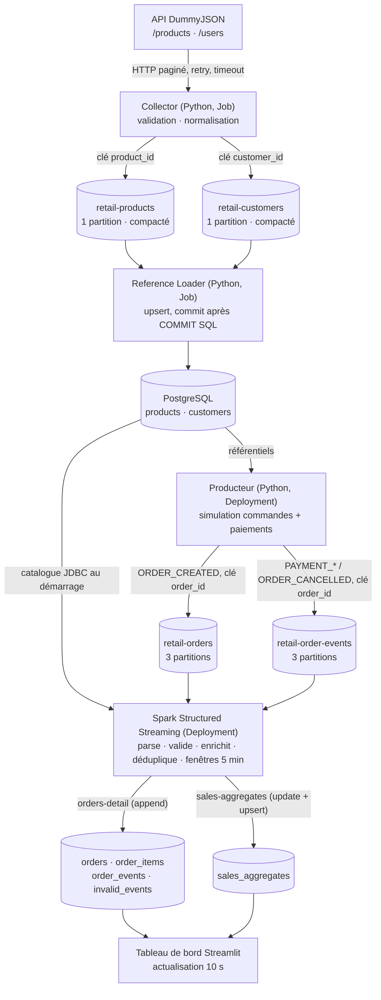
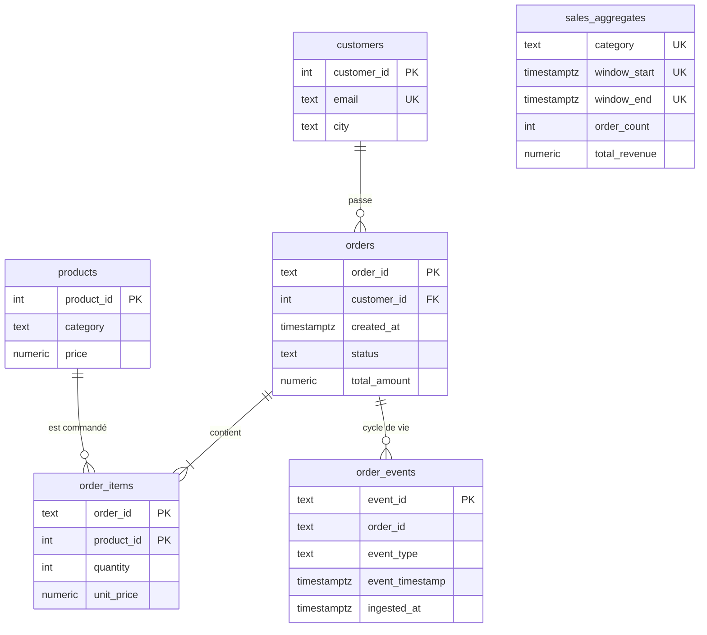
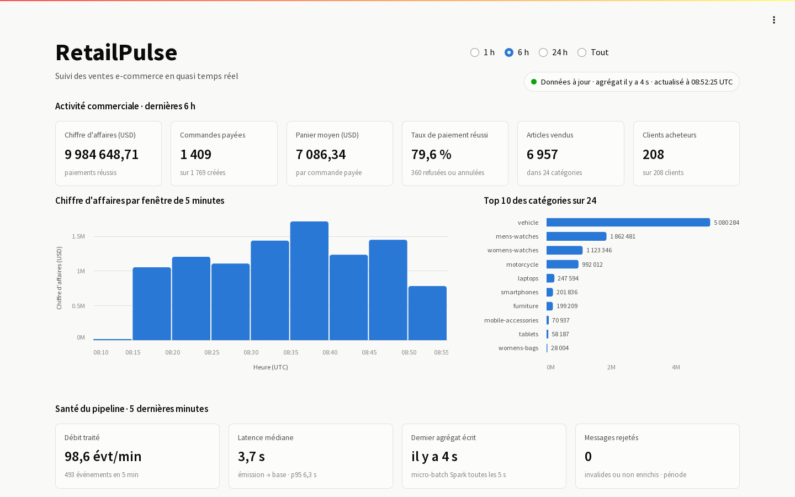
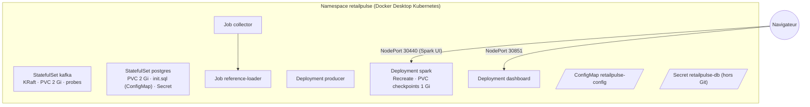

# RetailPulse — Dossier d'architecture

Plateforme distribuée pédagogique de traitement de données e-commerce en quasi temps réel :
DummyJSON → Kafka (KRaft) → Spark Structured Streaming → PostgreSQL → tableau de bord Streamlit,
déployée sous Docker Compose et sur Kubernetes.

> **Problématique.** Comment construire une chaîne de données distribuée, d'une source externe
> à des indicateurs consultables, en maîtrisant la qualité des données, les doublons, la cohérence,
> la persistance et la reprise après incident ?

## 1. Architecture fonctionnelle



**Principe fondamental.** DummyJSON ne fournit que les données de **référence** (194 produits,
208 utilisateurs). Les commandes et les résultats de paiement sont **simulés** par le producteur ;
rien n'est écrit dans l'API.

### Rôle, entrées et sorties des composants

| Composant | Type | Entrées | Sorties | Paramètres principaux |
|---|---|---|---|---|
| `apps/collector.py` | Job | API DummyJSON | `retail-products`, `retail-customers`, rapport JSON | `PAGE_SIZE` (50), `HTTP_TIMEOUT_S` (10), `DUMMYJSON_BASE_URL` |
| `apps/reference_loader.py` | Job | topics de référence | tables `products`, `customers` | `REPLAY_FROM_START`, `REFERENCE_LOADER_BATCH` |
| `apps/producer.py` | Deployment | tables de référence | `retail-orders`, `retail-order-events` | `MIN/MAX_INTERVAL_S` (0,5/2), `RATE`, `PAYMENT_SUCCESS_RATE` (0,8), `CANCEL_AFTER_FAIL_RATE` (0,5), `MAX_ITEMS` (4), `RANDOM_SEED` |
| `spark/streaming_job.py` | Deployment | topics d'événements, catalogue | `orders`, `order_items`, `order_events`, `invalid_events`, `sales_aggregates`, `stream_progress` | `WATERMARK_DELAY` (10 min), `WINDOW_DURATION` (5 min), `TRIGGER_INTERVAL` (5 s), `SPARK_MASTER` |
| `dashboard/app.py` | Deployment | PostgreSQL (lecture seule) | interface web | `REFRESH_SECONDS` (10), `STALE_AFTER_SECONDS` (120) |
| `apps/inject_event.py` | outil | référentiels | événements de test contrôlés | `--duplicate`, `--late-minutes`, `--invalid`… |

## 2. Collecte DummyJSON

* **Pagination explicite** `limit`/`skip` (pages de 50) jusqu'à atteindre `total`. `limit=0` renverrait
  tout d'un coup, mais la boucle illustre le traitement d'une API paginée et reste robuste si le
  volume grossit.
* **Contrôles de complétude** : présence du tableau et de `total`, `total` stable entre les pages,
  nombre reçu = `total`, identifiants uniques. Sinon `IncompleteCollection` et code retour ≠ 0 :
  le Job est relancé par Kubernetes (`backoffLimit: 4`).
* **Erreurs HTTP** : `Retry` urllib3 sur 429/5xx avec backoff exponentiel (1, 2, 4, 8 s), timeout
  de 10 s par requête.
* **Normalisation** : catégorie en minuscules, prix arrondi à 2 décimales, `brand` facultatif
  (absent de certains produits DummyJSON), e-mail en minuscules, ville extraite de `address.city`.
  Les enregistrements invalides sont journalisés et comptés (`rejected`), pas publiés.
* **Traçabilité** : `collected_at` et `source` dans chaque message ; rapport JSON (volumes reçus,
  publiés, rejetés, livrés) en fin de Job.
* **Limites de l'API** : données fictives et figées, écritures non persistées, pas de date de
  modification exploitable pour une collecte incrémentale (on recollecte tout, l'upsert absorbe).
  Les paniers (`/carts`) sont hors périmètre retenu : facultatifs, ils n'apportent rien au calcul
  des indicateurs demandés.

## 3. Kafka (KRaft)

* **Kafka 4.0 en mode KRaft combiné** (broker + controller dans le même processus), sans ZooKeeper.
* Listeners (séance 5) : `PLAINTEXT://kafka:29092` pour les conteneurs, `PLAINTEXT_HOST://localhost:9092`
  pour l'hôte, `CONTROLLER://:9093` pour le quorum. Sous Kubernetes : `kafka.retailpulse.svc.cluster.local:29092`.
* `auto.create.topics.enable=false` : les topics sont créés explicitement et de façon idempotente
  (`ensure_topics()`, même logique que le TP initial).

| Topic | Partitions | Clé | Politique | Justification |
|---|---|---|---|---|
| `retail-products` | 1 | `product_id` | compact | ≈ 200 messages ; la compaction garde le dernier état de chaque produit (référentiel rejouable) |
| `retail-customers` | 1 | `customer_id` | compact | idem |
| `retail-orders` | 3 | `order_id` | rétention 7 j | unité de parallélisme de Spark ; rejeu possible |
| `retail-order-events` | 3 | `order_id` | rétention 7 j | idem |

**Clé `order_id`** : tous les événements d'une même commande vont dans la même partition, donc
restent ordonnés. Cette clé a une très forte cardinalité, la charge est donc répartie uniformément.
Une clé `customer_id` exposerait à une *hot partition* si un client était très actif, et `store_id`
n'existe pas dans DummyJSON.

**Facteur de réplication = 1** : un seul broker, donc aucune autre machine pour héberger une copie.
Ce choix assumé ne permet pas de tolérer la perte du broker. En production, il faudrait 3 brokers,
RF=3 et `min.insync.replicas=2`.

**Producteurs** : `acks=all` et `enable.idempotence=true`. Les retries du producteur ne créent pas de
doublons dans Kafka.

## 4. Contrat des événements (JSON, `schema_version` 1)

```json
{
  "event_id": "3f6c3c2e-6c55-4d0e-9a59-0d8f0f4c1b7a",
  "event_type": "PAYMENT_COMPLETED",
  "event_timestamp": "2026-11-02T10:15:00.123Z",
  "order_id": "ORD-4F1A2B3C4D5E",
  "customer_id": 42,
  "items": [{"product_id": 7, "quantity": 2, "unit_price": 44.75}],
  "amount": 89.50,
  "currency": "USD",
  "source": "retailpulse-producer",
  "schema_version": 1,
  "payment_method": "CARD"
}
```

| Champ | Règle |
|---|---|
| `event_id` | UUID v4 unique par événement ; **clé de déduplication** |
| `event_type` | `ORDER_CREATED` (topic `retail-orders`) ; `PAYMENT_COMPLETED`, `PAYMENT_FAILED`, `ORDER_CANCELLED` (topic `retail-order-events`) |
| `event_timestamp` | heure de production, ISO-8601 UTC à la milliseconde, suffixe `Z` ; c'est l'**event time** des fenêtres |
| `order_id` | relie les événements d'un même cycle de vie ; clé Kafka |
| `customer_id` / `items[].product_id` | identifiants DummyJSON (référentiels) |
| `items[].unit_price` | prix **remisé** : `price × (1 − discountPercentage/100)` |
| `amount` / `currency` | montant **payé** = Σ quantité × prix remisé, en USD (devise des prix DummyJSON) |

Trois identifiants distincts : `event_id` (un fait), `order_id` (une commande, plusieurs faits) et
les identifiants de référentiel (`customer_id`, `product_id`).

**Cycle de vie simulé** : `ORDER_CREATED`, puis `PAYMENT_COMPLETED` (80 %) ou `PAYMENT_FAILED` (20 %).
Après un échec, `ORDER_CANCELLED` est émis une fois sur deux.

**Règle de chiffre d'affaires** : seuls les `PAYMENT_COMPLETED` sont comptés. **Compensation** : la
simulation n'annule jamais une commande payée (`ORDER_CANCELLED` ne suit qu'un `PAYMENT_FAILED`), donc
le CA n'a jamais à être corrigé. Pour annuler un paiement complété, il faudrait introduire un événement
`PAYMENT_REFUNDED` portant un montant négatif, agrégé dans la fenêtre de **son** event time (CA net).

## 5. Traitement Spark Structured Streaming

Image `apache/spark:3.5.6` en mode `local[2]` (driver et executors dans le même pod ; une
architecture maître/workers n'apporterait rien sur un seul nœud). Deux requêtes, chacune avec son
**checkpoint persistant** (volume Docker ou PVC) :

### Requête `orders-detail` (append, sans état)
1. lecture de `retail-orders` et `retail-order-events` (`startingOffsets=earliest`, trigger 5 s) ;
2. `value` → chaîne → `from_json` avec un schéma typé, en conservant topic, partition et offset ;
3. **validation** : chaque message reçoit une `reject_reason`, ou `null` s'il est valide :
   `JSON_INVALIDE`, `CHAMP_OBLIGATOIRE_MANQUANT`, `TYPE_INCONNU`, `TOPIC_INCOHERENT`, `ITEMS_INVALIDES`,
   `MONTANT_INCOHERENT`, `CLIENT_INCONNU`, `PRODUIT_INCONNU` ;
4. **enrichissement** : la catégorie de chaque article est ajoutée à partir du catalogue `products` ;
5. `foreachBatch` en une transaction PostgreSQL :
   * upsert de `orders`, avec une précédence de statut qui empêche toute régression ;
   * insertion idempotente de `order_items` et de `order_events` ;
   * isolement des messages rejetés dans `invalid_events`.

C'est donc **Spark qui alimente la table `orders`**, ce qui répond à l'exigence du §9. Les deux
topics sont lus par la même requête, donc un paiement peut être traité avant son `ORDER_CREATED` :
l'upsert crée alors la commande, puis `created_at = LEAST(...)` et la précédence de statut
rétablissent un état cohérent.

### Requête `sales-aggregates` (update, avec état)
```text
retail-order-events → parse → validation/enrichissement → filtre reject_reason IS NULL
  → filtre event_type = PAYMENT_COMPLETED                         (règle de CA)
  → withWatermark(event_timestamp, "10 minutes")                  (retard toléré)
  → dropDuplicatesWithinWatermark(event_id)                       (déduplication)
  → une ligne par (événement, catégorie) : quantité, CA            (explode_by_category)
  → groupBy(window(event_timestamp, "5 minutes"), category)
      count → order_count, sum → total_quantity, total_revenue, max(event_timestamp)
  → foreachBatch : upsert ON CONFLICT (category, window_start, window_end)
```

* **Enrichissement.** Le catalogue `product_id → category` est lu **par JDBC au démarrage** et
  injecté sous forme de map. Les items sont enrichis par la fonction d'ordre supérieur `transform()`,
  sans shuffle ni état. Limite : un produit ajouté après le démarrage n'est connu qu'au redémarrage
  suivant (le catalogue DummyJSON est figé), et l'événement en attendant part dans `invalid_events`.
* **`order_count` exact.** Un count-distinct n'est pas supporté en streaming, et une simple
  explosion par article compterait deux fois une commande qui contient deux produits de la même
  catégorie. On produit donc **une ligne par catégorie distincte de chaque commande**, avec
  `array_distinct`, `filter` et `aggregate` : une commande compte une fois par catégorie.
* **Watermark de 10 minutes.** Le watermark vaut `max(event_time vu) − 10 min`. Un événement plus
  ancien est ignoré par l'agrégat, et l'état des fenêtres plus anciennes est purgé, ce qui borne la
  mémoire. Il reste malgré tout tracé dans `order_events` par la requête 1. Exemple : un paiement de
  10:02 reçu à 10:07, alors que le watermark est à 09:57, est intégré.
* **Déduplication.** `dropDuplicatesWithinWatermark` conserve les `event_id` vus tant qu'ils restent
  dans le watermark. Hypothèse : un doublon arrive moins de 10 min après l'original, ce que
  garantissent les retries du producteur (de l'ordre de la seconde). Au-delà, la seconde barrière est
  la PK `order_events.event_id`, mais elle ne protège que le détail, pas l'agrégat.
* **Mode update et upsert « valeur complète ».** En mode update, Spark émet la **valeur totale
  courante** de chaque fenêtre modifiée, pas un delta. L'upsert `SET col = EXCLUDED.col` est donc
  **idempotent** : rejouer un micro-batch après une panne réécrit la même valeur.
* **Reprise.** Le checkpoint conserve les offsets Kafka, l'état (fenêtres et `event_id` vus) et le
  commit log. Après un arrêt, Spark rejoue le dernier batch non validé ; le sink idempotent l'absorbe.

## 6. Modèle de données PostgreSQL (`sql/init.sql`)



| Table | Alimentée par | Clé d'idempotence | Index justifiés |
|---|---|---|---|
| `products` | Reference Loader | PK `product_id` (DummyJSON) | `category` (regroupements, filtres) |
| `customers` | Reference Loader | PK `customer_id`, `email` UNIQUE | — |
| `orders` | Spark (requête 1) | PK `order_id` | `customer_id` (historique client, FK), `created_at DESC` (dernières commandes du dashboard) |
| `order_items` | Spark (requête 1) | PK `(order_id, product_id)` | couvert par la PK |
| `order_events` | Spark (requête 1) | PK `event_id` | `order_id` (cycle de vie), `ingested_at` (mesures de débit et de latence) |
| `invalid_events` | Spark (requête 1) | UNIQUE `(topic, partition, offset, reason)` | — |
| `sales_aggregates` | Spark (requête 2) | UNIQUE `(category, window_start, window_end)` | `window_start DESC` (courbe temporelle du dashboard) |
| `stream_progress` | listener Spark | PK `(query_name, run_id, batch_id)` | — |
| `aggregate_writes` | Spark (requête 2), même transaction que l'upsert | journal append-only (supervision) | `written_at` (fenêtres de mesure) |

`aggregate_writes` existe parce que `sales_aggregates.updated_at` est écrasé à chaque upsert :
pour mesurer la latence « dernier événement pris en compte → agrégat visible », il faut historiser
chaque écriture. C'est une table de supervision : un rejeu y ajoute une ligne sans aucun effet
sur les indicateurs.

Effet d'un **rejeu Spark** : toutes les écritures sont des upserts ou des `ON CONFLICT DO NOTHING`
sur des clés stables, et chaque micro-batch est écrit dans une seule transaction. Rejouer un batch
est donc sans effet visible.

## 7. Tableau de bord



Streamlit lit PostgreSQL en lecture seule toutes les 10 s (`st.fragment(run_every=10)`). Un filtre
de période (1 h, 6 h, 24 h, tout) en haut de page s'applique à toute la page. Le dashboard affiche :
* **Activité commerciale** : CA et commandes payées (avec variation par rapport à la période
  précédente), panier moyen, taux de paiement réussi, articles vendus, clients acheteurs ;
* **CA par fenêtre de 5 minutes** (barres couvrant chaque fenêtre) et **top 10 des catégories**
  (barres horizontales classées, valeur en bout de barre) ;
* **Santé du pipeline** sur les 5 dernières minutes : débit traité, latence médiane et p95
  (émission → base), ancienneté du dernier agrégat écrit, messages rejetés ;
* le **détail** en onglets : dernières commandes avec leur statut, dernières agrégations, toutes
  les catégories ;
* un badge d'état (données à jour, figées depuis plus de 120 s, base injoignable) et une section
  « Définitions des indicateurs ».

La présentation suit une palette unique, validée pour le contraste : une seule teinte pour les
séries, des couleurs d'état réservées aux états et toujours accompagnées d'un libellé, sans
emojis. Le dashboard **ne recalcule aucun agrégat métier** : il additionne les lignes de
`sales_aggregates` déjà calculées par Spark, compte les commandes par statut et en tire des ratios.

## 8. Architecture Kubernetes



| Ressource | Choix |
|---|---|
| Kafka | StatefulSet avec Service headless et ClusterIP `kafka:29092`, PVC, initContainer qui corrige les droits, readiness `kafka-broker-api-versions`, liveness TCP |
| PostgreSQL | StatefulSet, PVC (`PGDATA` en sous-dossier), schéma via ConfigMap `postgres-init`, probes `pg_isready` |
| Collector / Reference Loader | Jobs (`backoffLimit: 4`, `restartPolicy: OnFailure`, conservés pour consulter leurs logs), enchaînés par `k8s-deploy.sh` (`kubectl wait --for=condition=complete`) |
| Producer | Deployment, `terminationGracePeriodSeconds: 20` (SIGTERM puis flush) |
| Spark | Deployment à 1 réplica en stratégie `Recreate` (un PVC RWO ne s'attache qu'à un pod), PVC de checkpoint, readiness et liveness sur l'UI 4040 |
| Dashboard | Deployment avec Service NodePort 30851, probes `/_stcore/health` |
| Configuration | ConfigMap commune ; Secret créé depuis `.env` par `scripts/k8s-secret.sh` (jamais versionné) |
| Ressources | requests et limits sur tous les conteneurs (≈ 3,5 Gi de limites au total, compatible avec une VM Docker de 8 Go) |
| Réseau | DNS interne (`kafka`, `postgres`) ; `enableServiceLinks: false`, sinon les variables `KAFKA_*` injectées par Kubernetes seraient interprétées comme configuration du broker |

## 9. Garanties et limites par brique

| Brique | Garantie apportée | Limite |
|---|---|---|
| Producteur | idempotence Kafka (`acks=all`) : pas de doublon dû aux retries ; arrêt propre (flush) | un crash entre deux `produce` peut laisser une commande sans son paiement |
| Kafka | stockage durable et rejouable (rétention 7 j), ordre par partition | RF=1 : la perte du volume du broker perd les données |
| Reference Loader | at-least-once, upsert, donc rejouable sans doublon | — |
| Spark | reprise exacte des offsets et de l'état via checkpoint ; dédup dans le watermark | doublon au-delà de 10 min non dédupliqué dans l'agrégat ; événements trop tardifs ignorés |
| PostgreSQL | transactions par micro-batch, contraintes d'unicité, upserts | pas de réplication (instance unique) |
| Kubernetes | recrée les pods (Deployments et StatefulSets), relance les Jobs | un seul nœud : aucune tolérance à la panne du nœud |

**Bout en bout**, le système est at-least-once côté transport et effectively-once côté résultat
(Kafka idempotent, checkpoint Spark, sink idempotent). Aucun mécanisme isolé ne suffit : c'est leur
combinaison qui garantit l'absence de double comptage.
